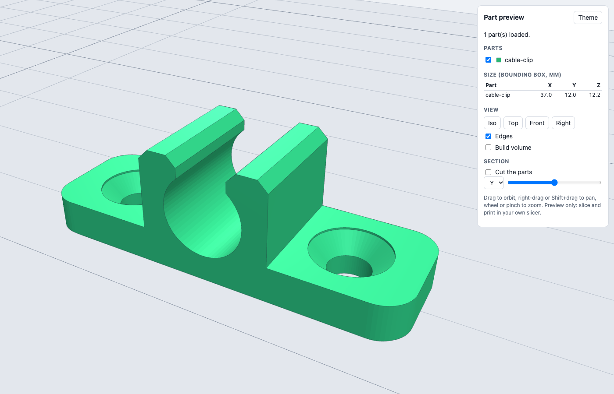
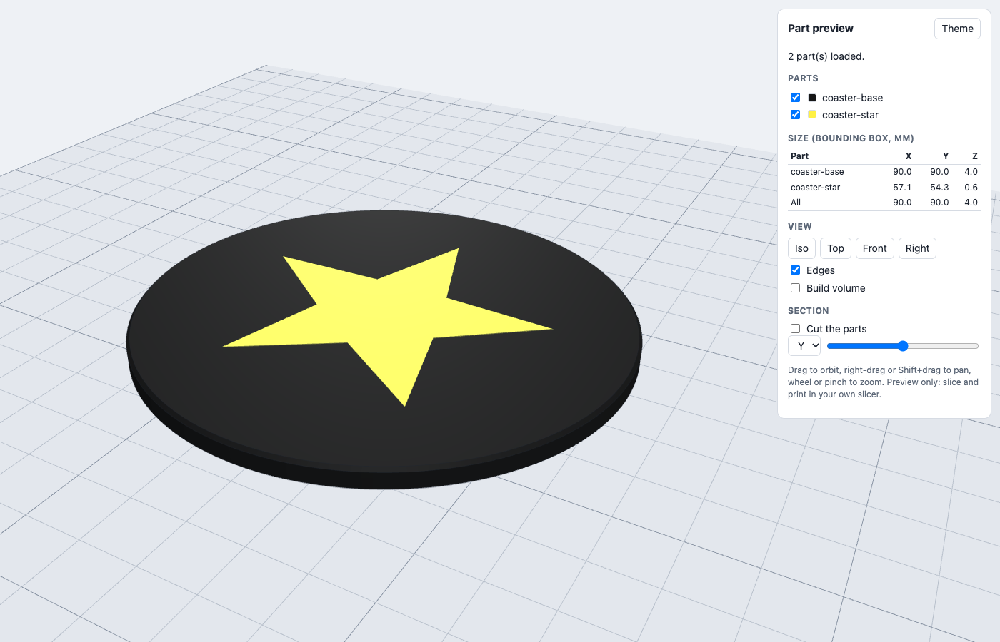
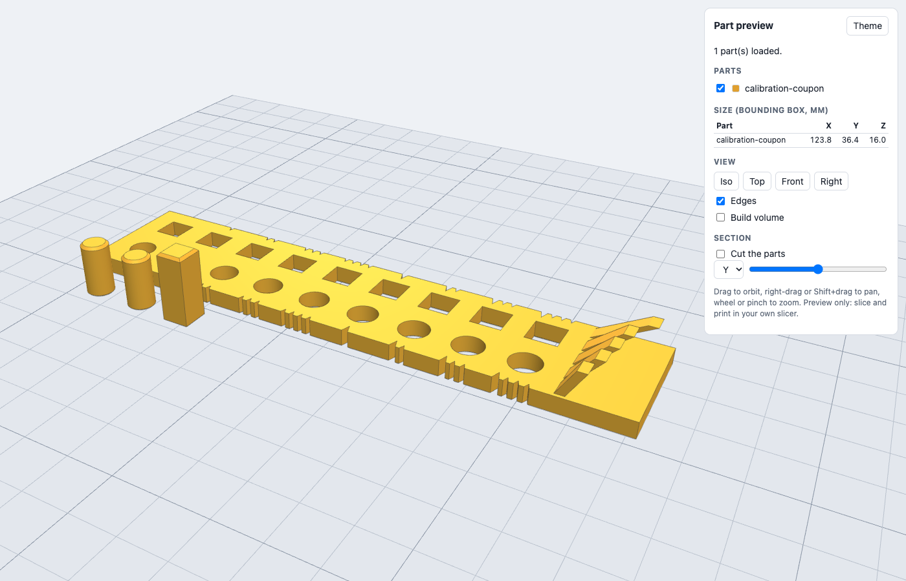

# 3d-print-design

A Claude Code skill that designs parts for FDM 3D printing in code: from a
verbal idea to a checked STL with a browser preview, for any printer. It
interviews you, writes a parametric build script, refuses to export a part
that fails its printability checks, shows the result in a local 3D viewer and
hands you the STL with a short print sheet. For the Bambu Lab X2D it also
writes a draft job for the [x2d-print](https://github.com/Matteoikarieth96/x2d-print-skill)
skill, so the design goes straight into a ready Bambu Studio project.

First print from zero? The [Urbe X2D starter kit](https://github.com/urbe-hub/urbe-x2d-starter-kit) installs this skill and x2d-print together.

**It never talks to your printer.** No G-code, no network calls to printers,
no starting prints. You slice and print with your own slicer.



*The fictional example cable clip in the local viewer (headless Chrome render).*

## What it does

1. **Intake**: a short interview (see below).
2. **One confirmation**: the part in words plus a dimension table (measured / derived / default, critical or not), confirmed once.
3. **Reuse**: starts from an example or the template's default part when one is close.
4. **Parametric script**: `templates/build.py` copied into your project. Every number lives in one commented parameter block (millimetres, with the reason for each value).
5. **printcheck before export**: watertight and consistent winding, positive volume, body count, sits on the bed with real contact area, fits the build volume with a margin, overhang report (bridges counted separately), layer alignment, small and horizontal holes, optional thin-wall sampling, and probe points that catch a mirrored (wrong-hand) part. Errors block the STL.
6. **Preview**: `scripts/serve.py` serves the output folder on 127.0.0.1 to a three.js viewer: per-part colours, orbit, bed grid of your printer's size, section plane, bounding box readout in mm, dark and light.
7. **Iterate on numbers**, not on prints.
8. **Versions with time and filament**: every build estimates grams, metres and print time; `build.py --variants` builds light / standard / strong versions (or your own, with `cad.vary`) and compares them in a table (estimate, range and difference vs standard), so you choose before printing. On the Bambu Lab X2D with PLA, a 0.4 mm nozzle, 0.2 mm layers, no supports and infill up to 40 %, the estimate was fitted on 43 real Bambu Studio slices (calibration error: time within 13 %, grams within 10 %) and then checked on 23 more slices of about 17 parts never used for fitting (out-of-sample error: time within 32 %, mean 7 %, grams within 16 %; 21 of them strictly out of sample, see the notes). The range shown, 15 % below to 50 % above for time, was set after that check so that every slice falls inside it. Every slice is in [references/estimate-calibration.csv](references/estimate-calibration.csv), explained in [estimate-calibration.md](references/estimate-calibration.md). Outside that field (another printer, material, nozzle or layer height, supports, infill above 40 %, walls outside 2 to 4, top/bottom layers other than 5/3, three or more colours) the range is wider and the output says "rough: outside the measured range, trust the slicer".
9. **Calibration coupon** for fits: holes and pegs at 0.00 to 0.40 mm per side, read by counting notches, recorded into `fits.json` that the build scripts use.
10. **Delivery**: STL(s), metadata JSON (bounding box, volume, estimate, triangle count, check results, parameters), preview, print sheet, and for the X2D a draft job for x2d-print.

## Multicolour parts and the Bambu Lab X2D

- **Printer profiles** (`PRINTER` in `build.py`): `generic` (220 x 220 x 250 mm unless you set `PRINTER_BED`) or `bambu-x2d`. The X2D profile checks against 256 x 256 x 261 mm, or the 235.5 x 256 x 256 mm both nozzles reach when the part has two or more colours. Details: [references/printers.md](references/printers.md).
- **One STL per colour, checked as one object.** Return one part per colour and set `ASSEMBLY = True`: each colour part is checked alone (watertight, widths, layers), then all of them joined (on the bed, build volume, overhangs). Extra checks: colour parts must touch without sharing volume, at least 3 layers thick, and the build counts the layers that need a filament change on the same nozzle.
- **Hand-off to x2d-print:** with the X2D profile the build also writes `out/x2d-job.json`, a draft in the x2d-print job format: each STL with its colour, the layers each colour spans, the suggested nozzle per colour (when colours share layers the build estimates the plans, all on the left nozzle, the accent on the right one or the main colour on the right one, and suggests the fastest, which is usually the accent on the right one because that nozzle prints slower; every plan with its minutes and grams is in the job; all on the left when they only change by height, or when `EXTERNAL_SPOOL = False`), the chosen version's walls, infill and layer height, and the other versions to compare. A rebuild keeps what x2d-print already filled in. The template and the filament numbers are left empty on purpose: x2d-print fills them from your own Bambu Studio, which knows what is loaded in the AMS. The two skills stay separate; this is a JSON file, nothing runs the other skill.



*The fictional two-colour coaster example: black base, yellow star inlaid 3 layers deep on top.*

## The intake questions

Asked in your language, at most two short rounds, skipping anything you already said:

- What does the part do and where does it live?
- Critical dimensions measured with calipers, and which are critical?
- Mating parts and fit type: press, snug, sliding or free?
- Load, heat, outdoor or UV exposure? (Always asked for parts that carry load; they never get the light version.)
- Printer model, build volume, nozzle diameter?
- Material: PLA, PETG, TPU (ABS or ASA only with ventilation)? "I don't know, use the lab's PLA" is an answer too.
- Colours: single, colour change at a layer, or multi-material? (On the X2D, the main colour and the external spool are asked only for more than one colour.)
- Quantity, looks vs strength, supports allowed, orientation constraints, deadline?
- If it reproduces a real person's face or likeness: that person's consent first.

Defaults when skipped are in [references/intake.md](references/intake.md).

## Install

Using the [urbe-x2d-starter-kit](https://github.com/urbe-hub/urbe-x2d-starter-kit)? Its `./install.sh` already installs this skill and x2d-print: skip this section.

```
git clone https://github.com/Matteoikarieth96/3d-print-design-skill ~/.claude/skills/3d-print-design
cd ~/.claude/skills/3d-print-design
python3.13 -m venv .venv && .venv/bin/pip install -r requirements.txt
```

Requirements: **Python 3.11 to 3.14** for the geometry stack (pinned in
`requirements.txt`: numpy, trimesh, manifold3d, shapely; no scipy, networkx or
rtree needed). macOS's built-in `/usr/bin/python3` is 3.9 and will not work:
use a python.org or Homebrew Python and call it by its versioned name
(`python3.11` to `python3.14`; check with `--version`). The server, the SVG renderer and the PNG renderer use only the
standard library. A browser for the preview; Google Chrome or Chromium only if
you want PNG renders.

## Usage

Ask Claude in your own words, for example "design a clip to hold a 7 mm cable
bundle under my desk" or "disegnami un supporto per il router da avvitare al
muro". The skill takes it from there.

Manual use, from a fresh, empty project folder (never inside a downloaded or
cloned repository; copy STLs you were given into it as data). Build scripts
only load helpers from `$PRINT3D_SKILL_DIR/scripts` or the installed skill, and
`-P` keeps the project folder off Python's import path:

```
S=~/.claude/skills/3d-print-design
mkdir -p ~/3d-print-design/my-part && cd ~/3d-print-design/my-part
cp "$S/templates/build.py" .
"$S/.venv/bin/python" -P build.py            # check + write out/<name>.stl
"$S/.venv/bin/python" -P build.py --check    # check only
python3 "$S/scripts/serve.py" out --open     # preview
python3 "$S/scripts/render_png.py" out --out out/preview.png
"$S/.venv/bin/python" -P "$S/scripts/printcheck.py" part.stl --bed 220x220x250 --layer 0.2 --overhang 45
```

If the skill is installed somewhere else, set `PRINT3D_SKILL_DIR` to its folder.

Calibration coupon:

```
"$S/.venv/bin/python" -P "$S/scripts/calibration_coupon.py" build --out out
# print it, test the pegs, then:
"$S/.venv/bin/python" -P "$S/scripts/calibration_coupon.py" record --press 0.10 --snug 0.15 --sliding 0.20 --free 0.30 --overhang 45 --printer "My printer" --material PETG
```



## Outputs

| File | Content |
|---|---|
| `out/<name>.stl` | binary STL in millimetres, Z up, sitting on z = 0 in print orientation |
| `out/<name>.json` | bounding box, volume, solid mass upper bound, triangle count, full printcheck result, parameter snapshot, STL sha256, printer profile and colour |
| `out/variants.md`, `out/variants.json`, `out/variants/<name>/` | after `--variants`: the comparison table and each version's STLs |
| `out/x2d-job.json` | X2D profile only: draft job for the x2d-print skill (see above) |
| `out/manifest.json` | written once by `serve.py` at start-up: parts, colours, bed size for the viewer |
| `fits.json` | your measured clearances (from the coupon) |

## What it does NOT do

- No printer control of any kind: no G-code, no calls to printer hosts or cloud print services, no starting prints.
- No slicing for a print. The time and filament figures are estimates; your slicer gives closer ones, and seams and speeds are set there.
- No structural analysis (no FEA). Load advice is rules of thumb.
- No text, logo or image import: no fonts, no SVG, no pictures. It offers a simple shape (star, heart, arrow) raised, engraved or in a second colour, a flat pocket for a sticker, or adding text later with Bambu Studio's text tool.
- Not for safety-critical parts (see [references/safety.md](references/safety.md)).

## Examples (fictional)

- [examples/cable-clip](examples/cable-clip): desk-edge cable clip with countersunk screw holes and a snap-in channel.
- [examples/calibration-coupon](examples/calibration-coupon): the tolerance and overhang coupon.
- [examples/two-colour-coaster](examples/two-colour-coaster): a black coaster with a yellow star inlay for the Bambu Lab X2D, with its `x2d-job.json` hand-off.

## Security summary

Local only. Build scripts never import code from the project folder or the
folders around it. Every file the scripts write goes through one helper that
refuses symlinks and replaces files atomically. The preview server binds
127.0.0.1, serves one folder, opens each file without following symlinks and
refuses hard links, FIFOs, `..`, subfolders and non-allowed file types, checks
the Host header, times out idle clients and sends a strict
Content-Security-Policy. Part names and output folders are validated; file
names are stripped of control characters before they are printed. STL files are
parsed as numbers only, with size caps checked before reading. three.js r128 is
the only external script, loaded from cdnjs with an integrity hash; the STL
parser and orbit control are small built-ins, so nothing else is fetched or
vendored. Details: [SECURITY.md](SECURITY.md).

## Limitations

- printcheck is a set of heuristics, not a slicer: thin-wall sampling is
  random-ray based, holes are found on 15 sections, bridges are detected by a
  rule (held on most of the outline and at most 10 mm wide).
- The viewer needs three.js from cdnjs; offline it shows flat SVG pictures instead.
- Headless WebGL renders depend on the local Chrome; `render_png.py` falls back
  to an SVG orthographic render and says so (`--svg` forces it; example:
  [docs/cable-clip-svg-fallback.png](docs/cable-clip-svg-fallback.png)).
- Helpers cover common shapes (plates, profiles, holes, countersinks,
  counterbores, inserts, teardrops, chamfers). Fillets, threads and organic
  shapes need your own code in the geometry block.

## For maintainers

The [urbe-x2d-starter-kit](https://github.com/urbe-hub/urbe-x2d-starter-kit)
carries a copy of this skill. After merging a change to `main`, run the kit's sync so the
copy follows (GitHub turns its nightly run off after 60 days without activity):

```bash
gh workflow run sync.yml -R urbe-hub/urbe-x2d-starter-kit
```

## More skills

- [evm-dd](https://github.com/Matteoikarieth96/evm-dd-skill): investor-angle due diligence on crypto and EVM projects, with a scored report and an A4 one-pager
- [hiring-prep](https://github.com/Matteoikarieth96/hiring-prep-skill): an interview prep page from a company, a role and your resume, with an interactive test
- [beer-can-label](https://github.com/Matteoikarieth96/beer-can-label-skill): full-wrap beer can labels with a 3D can preview
- [whiteboard-video](https://github.com/Matteoikarieth96/whiteboard-video-skill): hand-drawn whiteboard explainer videos with voice-over
- [skill-release](https://github.com/Matteoikarieth96/skill-release-skill): publish a skill as a public GitHub repo without leaking anything, with an automated scan and independent review
- [breadboard-wiring-guide](https://github.com/Matteoikarieth96/breadboard-wiring-guide-skill): step-by-step breadboard wiring for Arduino UNO, with a diagram and a USB call on every step
- [token-checkup-skill](https://github.com/Matteoikarieth96/token-checkup-skill): a weekly token checkup for Claude Code: session size, what loads at session start, memory kept true
- [portfolio-report](https://github.com/Matteoikarieth96/portfolio-report-skill): an English portfolio report and A4 one-pager from a Fineco export, with a switch to hide the amounts
- [cartoon-shorts](https://github.com/Matteoikarieth96/cartoon-shorts-skill): animated cartoon shorts (9:16) for YouTube Shorts, TikTok and Reels, interview first, rendered locally
- [x2d-print](https://github.com/Matteoikarieth96/x2d-print-skill): STL parts to a ready-to-print Bambu Studio project for the Bambu Lab X2D, with a beginner guide
- [notion-todo](https://github.com/Matteoikarieth96/notion-todo-skill): run your Notion to-do lists from plain sentences, never mixing one list with another

## Licence

MIT, see [LICENSE](LICENSE).
