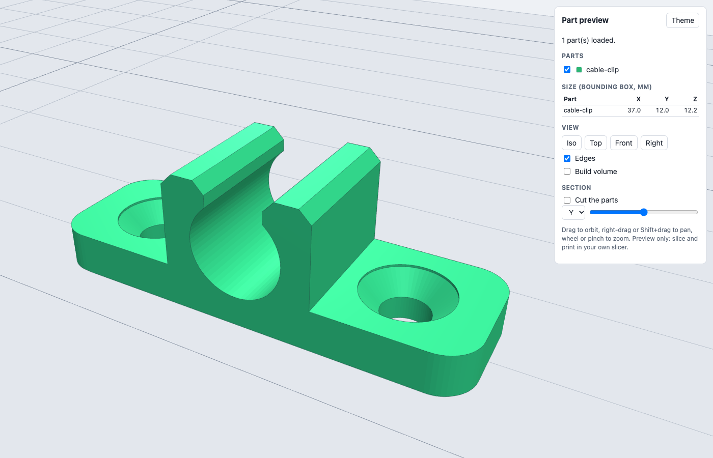

# Example: desk-edge cable clip (fictional)

A fictional, generic part to show the whole flow. The measurements below are
made up for the example, not taken from a real desk or product.



**Intake answers used:** hold a 7 mm bundle of two cables under the front
edge of a desk; plate screwed to the underside with two 3.5 mm countersunk
wood screws (7 mm heads); 220 x 220 x 250 printer, 0.4 nozzle, 0.2 layers;
PETG; single colour; no supports; quantity 4; balanced looks and strength.

**Design choices (all in the parameter block of `build.py`):**
- Plate flat on the bed, channel standing up, cable running along Y, so the
  snap lip flexes in the XY plane of each layer, never across layers.
- Cavity is a 45 degree teardrop: the roof never exceeds the overhang limit.
- Opening of 5 mm (about 70 % of the bundle) with a 1 mm 45 degree lead-in and
  a 2 mm lip: the bundle clicks in and stays.
- 0.4 mm bottom chamfer against elephant foot; countersinks 0.2 mm below the
  surface; screw clearance from `FITS["free"]`.
- Probe points: the channel wall must be solid; the cavity and both screw axes
  must be empty.

**Build and preview** (from this folder, with the repo's venv). Build scripts
never look for helper code in the folders around them, so name the skill
folder explicitly:

```
PRINT3D_SKILL_DIR="$(cd ../.. && pwd)" ../../.venv/bin/python -P build.py
python3 ../../scripts/serve.py out --open
```

printcheck result: watertight, 1 body, on the bed with 373 mm2 contact, no
overhang, all flat faces on 0.2 mm layers, 2 holes found, no thin walls, 4/4
probes. Outputs are committed in `out/`.

**Print sheet (short):** plate down as modelled, PETG 230 to 245 C nozzle, 75 to
85 C bed, 0.2 mm layers, 3 walls, 15 % infill (the standard version), no
supports, no brim. Estimate per clip: about 2.4 g and about 16 min (10 to
30 min), marked rough: outside the measured range, trust the slicer (generic
printer profile, PETG). For reference, the same clip in PLA on a Bambu Lab X2D
sliced at 15 min and 2.1 g. The intake said 4 copies; set `QUANTITY = 4` or
place 4 copies in the slicer.
